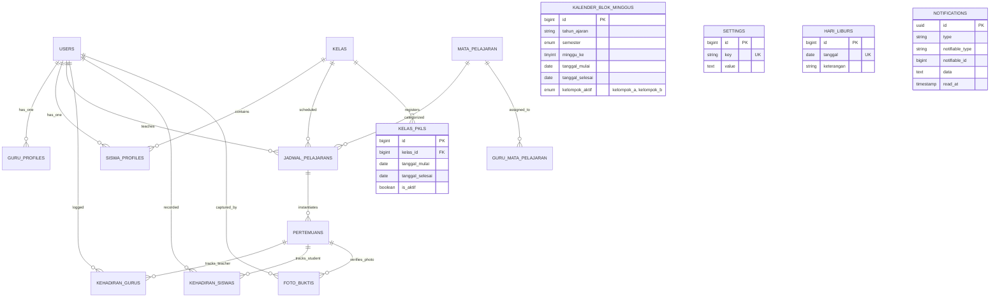

# PROJECT DISCOVERY REPORT — SOPAN (AGENDA MENGAJAR GURU)
**Aplikasi:** SOPAN (Sistem Operasional Presensi & Agenda Mengajar Guru) — SMK Negeri 1 Ciamis  
**Fase:** Phase 0 — Complete Project Discovery  
**Peran Auditor:** Senior Software Architect & Application Security Auditor  
**Waktu Selesai Audit:** 13 Oktober 2026  
**Status Working Tree:** Clean (`origin/main` at commit `9061d12c8dbd2c0104e84a2b637985bf1160225d`)  

---

## 1. Ringkasan Arsitektur

### 1.1 Metadata Repository & Lingkungan Eksekusi
* **Repository Path:** `c:\laragon\www\agenda-mengajar-guru`
* **Remote Origin:** `https://github.com/PradiptaPPLG/agenda-mengajar-guru.git`
* **Branch Aktif:** `main` (sinkron dengan `origin/main`, 0 uncommitted changes, working tree bersih)
* **Commit Terakhir:** `9061d12` (*test(safety): tambahkan suite pengujian regresi soft delete dan unifikasi pplg*)
* **Lingkungan Host:** Windows 10/11, Shell PowerShell, PHP runtime `8.5.0RC1`, Web Server lokal Laragon.

### 1.2 Stack Teknologi Terverifikasi
| Komponen | Spesifikasi / Paket | Bukti File Sumber |
|---|---|---|
| **Target Runtime PHP** | `^8.3` (Diuji pada PHP 8.5) | [composer.json](file:///c:/laragon/www/agenda-mengajar-guru/composer.json#L9) |
| **Framework Backend** | Laravel Framework `^13.17` | [composer.json](file:///c:/laragon/www/agenda-mengajar-guru/composer.json#L11) |
| **PDF Generation** | `barryvdh/laravel-dompdf: ^3.1` | [composer.json](file:///c:/laragon/www/agenda-mengajar-guru/composer.json#L10) |
| **Excel Processing** | `maatwebsite/excel: ^4.0` & `spatie/simple-excel: ^3.10` | [composer.json](file:///c:/laragon/www/agenda-mengajar-guru/composer.json#L13-L15) |
| **RBAC Package** | `spatie/laravel-permission: ^8.3` | [composer.json](file:///c:/laragon/www/agenda-mengajar-guru/composer.json#L14) |
| **Frontend Tooling** | `vite: ^8.0.0`, `laravel-vite-plugin: ^3.1` | [package.json](file:///c:/laragon/www/agenda-mengajar-guru/package.json#L12-L14) |
| **CSS Framework** | `tailwindcss: ^4.0.0` via `@tailwindcss/vite: ^4.0.0` | [package.json](file:///c:/laragon/www/agenda-mengajar-guru/package.json#L10-L13) |
| **Testing Suite** | PHPUnit `12.5.35` (SQLite in-memory isolated) | [phpunit.xml](file:///c:/laragon/www/agenda-mengajar-guru/phpunit.xml#L26-L27) |
| **Code Style** | Laravel Pint `^1.27` | [composer.json](file:///c:/laragon/www/agenda-mengajar-guru/composer.json#L22) |

### 1.3 Arsitektur Desain & Karakteristik Unik
1. **Multi-Identifier Authentication:** Pengguna dapat masuk menggunakan salah satu dari tiga identifier: `email`, `NIP` (guru via profil), atau `NIS` (siswa via profil) ([AuthController.php:L33-L41](file:///c:/laragon/www/agenda-mengajar-guru/app/Http/Controllers/AuthController.php#L33-L41)).
2. **Dual-Model Authorization:**
   - Proteksi rute HTTP utama dikendalikan oleh middleware tunggal `RoleMiddleware` yang memverifikasi kolom string `users.role` ([RoleMiddleware.php:L35](file:///c:/laragon/www/agenda-mengajar-guru/app/Http/Middleware/RoleMiddleware.php#L35)).
   - Spatie Permission terpasang sebagai pendukung tugas tambahan (BK, Kaprog, Wali Kelas, Piket) di tabel relasi `roles` dan `permissions`, namun belum diikatkan ke Gate/Policy standar Laravel.
3. **Dual-Capture Attendance System:** Alur presensi visual berbasis foto jam masuk (*Check-In*) dan jam selesai (*Check-Out*) dengan kompresi WebP otomatis di sisi client (GPU browser) dan server fallback ([ImageCompressor.php](file:///c:/laragon/www/agenda-mengajar-guru/app/Services/ImageCompressor.php)).
4. **Flexible Hybrid Scheduling:** Mendukung pembelajaran reguler mingguan, sistem blok rotasi mingguan (Kelompok A/B), sistem blok split harian, dan bypass PKL ([JadwalBlokResolverService.php](file:///c:/laragon/www/agenda-mengajar-guru/app/Services/JadwalBlokResolverService.php)).

---

## 2. Inventaris Modul dan Fitur

Aplikasi terbagi menjadi **12 modul fungsional** yang tersebar di 39 Controller dan 17 Model Eloquent:

| Modul | Peran / Pengguna | Entry Point Rute | Controller Utama | Model Terkait |
|---|---|---|---|---|
| **1. Autentikasi & Akun** | Publik, Semua Role | `/login`, `/logout`, `/profile` | [AuthController.php](file:///c:/laragon/www/agenda-mengajar-guru/app/Http/Controllers/AuthController.php), [ProfileController.php](file:///c:/laragon/www/agenda-mengajar-guru/app/Http/Controllers/ProfileController.php) | `User`, `GuruProfile`, `SiswaProfile` |
| **2. Public Display & Monitoring** | Publik (Monitor Lobi) | `/` (`home`) | [PublicDashboardController.php](file:///c:/laragon/www/agenda-mengajar-guru/app/Http/Controllers/PublicDashboardController.php) | `KehadiranGuru`, `KehadiranSiswa`, `JadwalPelajaran`, `KelasPkl` |
| **3. Presensi Visual Siswa** | `siswa` | `/siswa/dashboard`, `/siswa/jadwal/{id}/capture/{tanggal}` | [CaptureController.php](file:///c:/laragon/www/agenda-mengajar-guru/app/Http/Controllers/Siswa/CaptureController.php) | `FotoBukti`, `Pertemuan`, `JadwalPelajaran`, `SiswaProfile` |
| **4. Jurnal & Agenda Guru** | `guru` | `/guru/dashboard`, `/guru/jadwal/{id}/pertemuan/{tgl}` | [PertemuanController.php](file:///c:/laragon/www/agenda-mengajar-guru/app/Http/Controllers/Guru/PertemuanController.php) | `Pertemuan`, `KehadiranGuru`, `KehadiranSiswa`, `FotoBukti` |
| **5. Rekap Presensi Guru** | `guru` | `/guru/rekap`, `/guru/rekap/export-*` | [RekapController.php](file:///c:/laragon/www/agenda-mengajar-guru/app/Http/Controllers/Guru/RekapController.php) | `KehadiranSiswa`, `Pertemuan`, `Kelas` |
| **6. Tugas Tambahan: Wali Kelas** | `guru` (Wali Kelas) | `/guru/wali-kelas`, `/guru/wali-kelas/siswa/*` | [WaliKelasController.php](file:///c:/laragon/www/agenda-mengajar-guru/app/Http/Controllers/Guru/WaliKelasController.php) | `Kelas`, `SiswaProfile`, `KehadiranSiswa` |
| **7. Tugas Tambahan: BK & Kaprog** | `guru` (BK, Kaprog) | `/guru/bk`, `/guru/kaprog` | [BkController.php](file:///c:/laragon/www/agenda-mengajar-guru/app/Http/Controllers/Guru/BkController.php), [KaprogController.php](file:///c:/laragon/www/agenda-mengajar-guru/app/Http/Controllers/Guru/KaprogController.php) | `Kelas`, `GuruProfile`, `KehadiranSiswa` |
| **8. Pos Petugas Piket** | `piket`, `admin` | `/piket/dashboard`, `/piket/tegur` | [Piket/DashboardController.php](file:///c:/laragon/www/agenda-mengajar-guru/app/Http/Controllers/Piket/DashboardController.php), [TeguranController.php](file:///c:/laragon/www/agenda-mengajar-guru/app/Http/Controllers/Piket/TeguranController.php) | `JadwalPelajaran`, `KehadiranGuru`, `Notification` |
| **9. Administrasi Master Data** | `admin`, `super_admin` | `/admin/users`, `/admin/siswa`, `/admin/kelas`, `/admin/mata-pelajaran`, `/admin/jadwal` | [UserController.php](file:///c:/laragon/www/agenda-mengajar-guru/app/Http/Controllers/Admin/UserController.php), [SiswaController.php](file:///c:/laragon/www/agenda-mengajar-guru/app/Http/Controllers/Admin/SiswaController.php), [KelasController.php](file:///c:/laragon/www/agenda-mengajar-guru/app/Http/Controllers/Admin/KelasController.php), [JadwalController.php](file:///c:/laragon/www/agenda-mengajar-guru/app/Http/Controllers/Admin/JadwalController.php) | `User`, `Kelas`, `MataPelajaran`, `JadwalPelajaran` |
| **10. Kalender & Pemetaan Blok** | `admin`, `super_admin` | `/admin/kalender-blok`, `/admin/pemetaan-blok` | [KalenderBlokController.php](file:///c:/laragon/www/agenda-mengajar-guru/app/Http/Controllers/Admin/KalenderBlokController.php), [PemetaanBlokController.php](file:///c:/laragon/www/agenda-mengajar-guru/app/Http/Controllers/Admin/PemetaanBlokController.php) | `KalenderBlokMinggu`, `Kelas`, `SiswaProfile` |
| **11. Transisi Kenaikan Kelas & PKL** | `admin`, `super_admin` | `/admin/kenaikan-kelas`, `/admin/kelas-pkl` | [KenaikanKelasController.php](file:///c:/laragon/www/agenda-mengajar-guru/app/Http/Controllers/Admin/KenaikanKelasController.php), [KelasPklController.php](file:///c:/laragon/www/agenda-mengajar-guru/app/Http/Controllers/Admin/KelasPklController.php) | `Kelas`, `SiswaProfile`, `KelasPkl`, `Setting` |
| **12. Pengaturan & Pelaporan Eksekutif** | `kepala_sekolah`, `pengawas`, `tu`, `super_admin` | `/kepala-sekolah/*`, `/tu/dashboard`, `/super-admin/settings` | [KsReportController.php](file:///c:/laragon/www/agenda-mengajar-guru/app/Http/Controllers/KepalaSekolah/ReportController.php), [SaSettingsController.php](file:///c:/laragon/www/agenda-mengajar-guru/app/Http/Controllers/SuperAdmin/SettingsController.php) | `Setting`, `KehadiranGuru`, `KehadiranSiswa` |

---

## 3. Matriks Role dan Otorisasi

### 3.1 Matriks Hak Akses Rute Berdasarkan Kode Aktual (`routes/web.php`)

| Fitur / Modul | Publik | Siswa | Guru | Wali Kelas | Guru BK | Kaprog | Piket | TU | Kepala Sekolah / Pengawas | Admin | Super Admin |
|---|:---:|:---:|:---:|:---:|:---:|:---:|:---:|:---:|:---:|:---:|:---:|
| **Public Realtime Dashboard (`/`)** | ✅ | ✅ | ✅ | ✅ | ✅ | ✅ | ✅ | ✅ | ✅ | ✅ | ✅ |
| **Login / Logout / Reset Sendiri** | ✅ | ✅ | ✅ | ✅ | ✅ | ✅ | ✅ | ✅ | ✅ | ✅ | ✅ |
| **Capture Foto Masuk/Pulang Siswa** | ❌ | ✅ | ❌ | ❌ | ❌ | ❌ | ❌ | ❌ | ❌ | ❌ | ❌ |
| **Isi Jurnal & Presensi Kelas Sendiri** | ❌ | ❌ | ✅ | ✅ | ✅ | ✅ | ❌ | ❌ | ❌ | ❌ | ❌ |
| **Download Foto Bukti Pertemuan** | ❌ | ❌ | ⚠️(Ampuan) | ⚠️(Ampuan) | ⚠️(Ampuan) | ⚠️(Ampuan) | ✅ | ❌ | ✅ | ✅ | ✅ |
| **Monitoring & Toggle Siswa Perwalian** | ❌ | ❌ | ❌ | ✅ | ❌ | ❌ | ❌ | ❌ | ❌ | ✅ | ✅ |
| **Monitoring Bimbingan Konseling (BK)** | ❌ | ❌ | ❌ | ❌ | ✅ | ❌ | ❌ | ❌ | ❌ | ✅ | ✅ |
| **Monitoring Jurusan (Kaprog)** | ❌ | ❌ | ❌ | ❌ | ❌ | ✅ | ❌ | ❌ | ❌ | ✅ | ✅ |
| **Teguran Guru Belum Masuk Kelas** | ❌ | ❌ | ❌ | ❌ | ❌ | ❌ | ✅ | ❌ | ❌ | ✅ | ✅ |
| **Laporan Eksekutif & Unduh PDF/XLS** | ❌ | ❌ | ❌ | ❌ | ❌ | ❌ | ❌ | ⚠️(Dash) | ✅ | ✅ | ✅ |
| **CRUD Master Data & Import/Export** | ❌ | ❌ | ❌ | ❌ | ❌ | ❌ | ❌ | ❌ | ❌ | ✅ | ✅ |
| **Wizard Kenaikan Kelas & Tutup Tahun** | ❌ | ❌ | ❌ | ❌ | ❌ | ❌ | ❌ | ❌ | ❌ | ✅ | ✅ |
| **Pengaturan Global Sekolah (`settings`)**| ❌ | ❌ | ❌ | ❌ | ❌ | ❌ | ❌ | ❌ | ❌ | ❌ | ✅ |

### 3.2 Pola Keamanan Otorisasi yang Teridentifikasi
* **IDOR Protection Terverifikasi:**
  - `CaptureController` memverifikasi jadwal milik kelas siswa (`$jadwal->kelas_id === $kelas?->id`) dan memblokir siswa non-aktif ([CaptureController.php:L38](file:///c:/laragon/www/agenda-mengajar-guru/app/Http/Controllers/Siswa/CaptureController.php#L38)).
  - `PertemuanController` membatasi pengisian jurnal hanya untuk guru pengampu (`$pertemuan->jadwal->guru_id === Auth::id()`) ([PertemuanController.php:L94](file:///c:/laragon/www/agenda-mengajar-guru/app/Http/Controllers/Guru/PertemuanController.php#L94)).
  - `WaliKelasController` memverifikasi bahwa aksi toggle siswa hanya diizinkan untuk siswa di dalam kelas perwaliannya sendiri via `authorizeKelas()` ([WaliKelasController.php:L395-L402](file:///c:/laragon/www/agenda-mengajar-guru/app/Http/Controllers/Guru/WaliKelasController.php#L395-L402)).
* **Area Perhatian Otorisasi:**
  - Hak akses Spatie Permission di `/admin/permissions` dan `/admin/roles` berdiri sendiri secara UI; perubahan permission di Spatie UI belum otomatis berdampak pada `RoleMiddleware` berbasis kolom `users.role`.

---

## 4. Cetak Biru Database & Diagram ERD



### 4.1 Kebijakan Retensi & Soft Deletes
* **SoftDeletes Aktif pada:** `users`, `kelas`, `mata_pelajarans`, `jadwal_pelajarans`.
* **Non-SoftDelete (Transaksi Kuat):** `siswa_profiles`, `pertemuans`, `kehadiran_gurus`, `kehadiran_siswas`, `foto_buktis`.
* **Foreign Key Cascade:** `kehadiran_siswas.siswa_id` dan `foto_buktis.siswa_id` memiliki constraint database `ON DELETE CASCADE` ke `users.id`. Oleh karena itu, penghapusan siswa dalam siklus hidup normal aplikasi wajib menggunakan **Soft Deletes** agar riwayat presensi lampau tidak terhapus di tingkat basis data.

---

## 5. Peta Alur Bisnis End-to-End

### 5.1 Alur Presensi KBM & Dual Capture Foto
1. **Siswa:** Mengakses `/siswa/jadwal/{id}/capture/{tanggal}`.
2. **Security Pre-Check:** Sistem memeriksa status akun siswa (`is_active = true`), kepemilikan kelas, status PKL kelas, dan kalender blok (Kelompok A/B).
3. **Capture Masuk:** Siswa mengambil foto kamera (dikompresi via GPU client ke WebP <300KB) dan menandai status guru (Hadir/Terlambat/Digantikan).
4. **Backend Processing:** [CaptureController::store()](file:///c:/laragon/www/agenda-mengajar-guru/app/Http/Controllers/Siswa/CaptureController.php#L191) membuat atau memutakhirkan [Pertemuan](file:///c:/laragon/www/agenda-mengajar-guru/app/Models/Pertemuan.php), [KehadiranGuru](file:///c:/laragon/www/agenda-mengajar-guru/app/Models/KehadiranGuru.php), dan menyimpan berkas ke `storage/app/public/foto-bukti/` via [ImageCompressor](file:///c:/laragon/www/agenda-mengajar-guru/app/Services/ImageCompressor.php).
5. **Checkout Capture:** Pada akhir jam pelajaran, siswa mengirimkan foto check-out via `/capture/checkout` untuk mencatat durasi kepulangan guru.

### 5.2 Alur Jurnal Mengajar & Presensi Siswa oleh Guru
1. **Guru:** Membuka `/guru/jadwal/{id}/pertemuan/{tanggal}`.
2. **Inisialisasi Pertemuan:** [PertemuanController::show()](file:///c:/laragon/www/agenda-mengajar-guru/app/Http/Controllers/Guru/PertemuanController.php#L27) membuat baris pertemuan dan menyajikan daftar siswa rombel.
3. **Penyimpanan Transaksional:** Guru mengisi judul materi, deskripsi penugasan, dan status kehadiran setiap siswa. Data disimpan dalam satu transaksi atomik [PertemuanController::saveAll()](file:///c:/laragon/www/agenda-mengajar-guru/app/Http/Controllers/Guru/PertemuanController.php#L91) yang mencakup seluruh JP berurutan (*consecutive schedules*).
4. **Locking Window:** Pertemuan terkunci otomatis jika melewati batas 7 hari ke belakang untuk menjaga akuntabilitas audit KBM.

### 5.3 Alur Kenaikan Kelas & Tutup Tahun Ajaran
1. **Admin:** Membuka wizard `/admin/kenaikan-kelas`.
2. **Pemetaan Otomatis:** Sistem menyarankan rombel tujuan: Kelas 11 &rarr; Kelas 12, Kelas 10 &rarr; Kelas 11 (termasuk normalisasi PPLG).
3. **Filter Retensi:** Admin memilih siswa tinggal kelas via modal AJAX [KenaikanKelasController::getSiswaKelas()](file:///c:/laragon/www/agenda-mengajar-guru/app/Http/Controllers/Admin/KenaikanKelasController.php#L92).
4. **Eksekusi Atomik:** Berjalan di dalam `DB::transaction()`:
   - Siswa kelas 12 diluluskan (`is_active = false`, `kelas_id = null`).
   - Siswa kelas 11 dan 10 non-retensi dipindahkan ke `kelas_id` tingkat berikutnya.
   - Tahun ajaran baru dikalkulasi dan semester di-reset ke Semester 1 Ganjil.

---

## 6. Peta Dependensi Lintas Modul

```
[User Model]
   ├── GuruProfile / SiswaProfile (Data Master)
   ├── JadwalPelajaran (Foreign Key guru_id)
   ├── Pertemuan (KehadiranGuru & FotoBukti)
   ├── KehadiranSiswa (Foreign Key siswa_id)
   └── Auth & RoleMiddleware (Session & Hak Akses)

[Kelas Model]
   ├── SiswaProfile (Foreign Key kelas_id)
   ├── JadwalPelajaran (Foreign Key kelas_id)
   ├── KelasPkl (Bypass Jadwal PKL)
   ├── KalenderBlokMinggu (Rotasi Kelompok A/B)
   └── KenaikanKelasController (Pemetaan & Retensi)

[MataPelajaran Model]
   ├── JadwalPelajaran (Foreign Key mata_pelajaran_id)
   ├── guru_mata_pelajaran (Pivot Guru Pengampu)
   └── RekapController & PublicDashboard (Statistik JP)
```

---

## 7. Inventaris Test dan Cakupannya

### 7.1 Status Test Suite Terkini
* **Hasil Pengujian Lengkap:** **118 PASSED**, 0 FAILED, 1 SKIPPED, 639 ASSERTIONS (Waktu eksekusi: 45.9 detik).
* **Konfigurasi Lingkungan:** `sqlite :memory:` sepenuhnya terisolasi dari database riil lokal maupun server.

### 7.2 Daftar 23 File Feature Test:
1. [AdminLoginTest.php](file:///c:/laragon/www/agenda-mengajar-guru/tests/Feature/AdminLoginTest.php): Alur login dan proteksi autentikasi admin.
2. [DefaultSiswaStatusTest.php](file:///c:/laragon/www/agenda-mengajar-guru/tests/Feature/DefaultSiswaStatusTest.php): Pengaturan status aktif default siswa baru.
3. [Fase3EnhancementsTest.php](file:///c:/laragon/www/agenda-mengajar-guru/tests/Feature/Fase3EnhancementsTest.php): Validasi fitur lanjutan fase 3.
4. [FotoBuktiDownloadTest.php](file:///c:/laragon/www/agenda-mengajar-guru/tests/Feature/FotoBuktiDownloadTest.php): Otorisasi unduh ZIP foto bukti dan verifikasi file.
5. [GuruDetailAndClassAssignmentTest.php](file:///c:/laragon/www/agenda-mengajar-guru/tests/Feature/GuruDetailAndClassAssignmentTest.php): Penugasan kelas dan detail guru.
6. [GuruImportTest.php](file:///c:/laragon/www/agenda-mengajar-guru/tests/Feature/GuruImportTest.php): Import guru via Excel dan penanganan duplikasi NIP.
7. [GuruPasswordNipTest.php](file:///c:/laragon/www/agenda-mengajar-guru/tests/Feature/GuruPasswordNipTest.php): Fitur reset password guru ke NIP.
8. [HariLiburManagementTest.php](file:///c:/laragon/www/agenda-mengajar-guru/tests/Feature/HariLiburManagementTest.php): Pengelolaan kalender libur dan dampak ke KBM.
9. [JadwalConflictValidationTest.php](file:///c:/laragon/www/agenda-mengajar-guru/tests/Feature/JadwalConflictValidationTest.php): Validasi anti-bentrok waktu mengajar guru dan kelas.
10. [KelasPklManagementTest.php](file:///c:/laragon/www/agenda-mengajar-guru/tests/Feature/KelasPklManagementTest.php): Manajemen PKL kelas 12 dan bypass jadwal.
11. [KenaikanKelasTest.php](file:///c:/laragon/www/agenda-mengajar-guru/tests/Feature/KenaikanKelasTest.php): Promosi massal kelas dan retensi siswa tinggal kelas.
12. [MataPelajaranImportTest.php](file:///c:/laragon/www/agenda-mengajar-guru/tests/Feature/MataPelajaranImportTest.php): Import mata pelajaran dan kode mapel.
13. [PengawasDanManajemenPenggunaTest.php](file:///c:/laragon/www/agenda-mengajar-guru/tests/Feature/PengawasDanManajemenPenggunaTest.php): Akses pengawas sekolah dan filter pengguna.
14. [PertemuanIntegrityTest.php](file:///c:/laragon/www/agenda-mengajar-guru/tests/Feature/PertemuanIntegrityTest.php): Integritas transaksi penyimpanan pertemuan guru.
15. [PiketAndAttendanceWorkflowTest.php](file:///c:/laragon/www/agenda-mengajar-guru/tests/Feature/PiketAndAttendanceWorkflowTest.php): Alur pemantauan piket dan teguran guru.
16. [ProductionSafetyRegressionTest.php](file:///c:/laragon/www/agenda-mengajar-guru/tests/Feature/ProductionSafetyRegressionTest.php): 11 skenario regresi soft-delete, HTTP GET idempotency, unifikasi PPLG, dan migrasi rollback.
17. [RecentFeaturesAuditTest.php](file:///c:/laragon/www/agenda-mengajar-guru/tests/Feature/RecentFeaturesAuditTest.php): Audit fitur-fitur mutakhir sistem.
18. [SemesterLifecycleTest.php](file:///c:/laragon/www/agenda-mengajar-guru/tests/Feature/SemesterLifecycleTest.php): Siklus hidup pergantian semester dan salin jadwal.
19. [SiswaImportTest.php](file:///c:/laragon/www/agenda-mengajar-guru/tests/Feature/SiswaImportTest.php): Import siswa via Excel dan penanganan NIS.
20. [SiswaPasswordNisTest.php](file:///c:/laragon/www/agenda-mengajar-guru/tests/Feature/SiswaPasswordNisTest.php): Fitur reset password siswa ke NIS.
21. [UserManagementFilterTest.php](file:///c:/laragon/www/agenda-mengajar-guru/tests/Feature/UserManagementFilterTest.php): Filter pencarian dan pagination manajemen pengguna.
22. [WaliKelasAndToleranceSecurityTest.php](file:///c:/laragon/www/agenda-mengajar-guru/tests/Feature/WaliKelasAndToleranceSecurityTest.php): Proteksi IDOR wali kelas dan aturan toleransi keterlambatan.
23. [ExampleTest.php](file:///c:/laragon/www/agenda-mengajar-guru/tests/Feature/ExampleTest.php): Pemeriksaan respon dasar rute awal.

---

## 8. Inventaris Konfigurasi Deployment

* **Asset Bundling:** Memerlukan kompilasi Vite sebelum produksi (`npm run build`). Menghasilkan manifest di `public/build/manifest.json`.
* **Symlink File Publik:** Memerlukan eksekusi `php artisan storage:link` agar direktori foto bukti di `storage/app/public` dapat diakses dan diunduh secara sah oleh aplikasi.
* **Driver Storage & Cache:**
  - Standar default menggunakan driver `local` untuk filesystem dan `database` untuk cache/sessions ([.env.example:L30-L40](file:///c:/laragon/www/agenda-mengajar-guru/.env.example#L30-L40)).
* **Database Driver Produksi:** Menggunakan MySQL/MariaDB (pada domain `agenda-guru.smkn1ciamis.id`).
* **CI/CD Pipeline:** Belum ditemukan file workflow otomatis GitHub Actions (`.github/workflows`) di repository ini. Deployment dilakukan melalui penarikan kode (*git pull*) manual atau skrip webhook server.

---

## 9. Daftar Area Risiko Awal untuk Audit Lanjutan

1. **Sinkronisasi Otomatis Foto Bukti Fisik:**
   - [PertemuanController::downloadAllFoto()](file:///c:/laragon/www/agenda-mengajar-guru/app/Http/Controllers/Guru/PertemuanController.php#L204) mengemas foto langsung dari disk ke file ZIP sementara di `sys_get_temp_dir()`. Perlu diaudit penggunaan resource memori dan disk ketika banyak guru mengunduh arsip foto berukuran besar secara bersamaan.
2. **Kesesuaian Format Impor Excel Skala Besar:**
   - [JadwalImport.php](file:///c:/laragon/www/agenda-mengajar-guru/app/Imports/JadwalImport.php#L30) menetapkan `set_time_limit(300)`. Jika server produksi membatasi waktu eksekusi PHP (misal max execution time 30s di FastCGI/PHP-FPM), impor jadwal ratusan baris berisiko timeout 504 Gateway.
3. **Penyelarasan Role Spatie vs Role Column:**
   - Terdapat dua jalur data role: kolom `users.role` (pengontrol rute utama) dan tabel pivot `model_has_roles` (Spatie). Perlu audit menyeluruh apakah ada potensi inkonsistensi saat super admin menyunting peran pengguna di UI `/admin/pengguna` dan `/admin/roles`.
4. **Kapasitas Penyimpanan Disk untuk Foto WebP:**
   - Walaupun foto dikompresi ke WebP (<300KB), sekolah dengan ratusan jam KBM per hari akan mengakumulasi ribuan file foto per semester. Perlu diaudit strategi pembersihan (*pruning*) atau pengarsipan berkala.

---

## 10. Daftar Informasi yang Belum Tersedia (Unverified)
1. **Spesifikasi Spesifik Server Produksi:** Kapasitas disk space server, versi exact web server (Nginx vs Apache), batas `upload_max_filesize` dan `post_max_size` pada PHP server produksi.
2. **Backup Otomatis di Server:** Apakah server produksi memiliki cronjob dump database terjadwal harian/mingguan di luar aplikasi.

---

## 11. Daftar File dan Modul yang Membutuhkan Audit Mendalam Selanjutnya
1. [app/Http/Controllers/PublicDashboardController.php](file:///c:/laragon/www/agenda-mengajar-guru/app/Http/Controllers/PublicDashboardController.php): Audit performa query agregasi real-time monitor lobi agar tidak membebani database sekolah pada jam sibuk.
2. [app/Imports/JadwalImport.php](file:///c:/laragon/www/agenda-mengajar-guru/app/Imports/JadwalImport.php): Audit toleransi kesalahan input human-error pada format jam, nama guru tanpa spasi, dan penamaan rombel yang tidak terdaftar.
3. [app/Http/Controllers/Admin/KenaikanKelasController.php](file:///c:/laragon/www/agenda-mengajar-guru/app/Http/Controllers/Admin/KenaikanKelasController.php): Audit ketahanan edge-case saat ada siswa pindahan atau siswa dengan profile ganda selama proses transisi semester.
4. [app/Http/Controllers/Admin/PenggunaController.php](file:///c:/laragon/www/agenda-mengajar-guru/app/Http/Controllers/Admin/PenggunaController.php): Audit sinkronisasi antara Spatie roles dan kolom `users.role`.

---

## 12. Rekomendasi Urutan Audit Menyeluruh Berikutnya
* **Tahap 1:** Audit Keamanan Input & File Upload Handling (Validasi MIME, Magic Byte, batas ukuran, dan isolasi storage).
* **Tahap 2:** Audit Ketahanan & Skalabilitas Impor Data Massal (Excel parsing, batas waktu eksekusi PHP-FPM, transaksi rollback saat error baris tengah).
* **Tahap 3:** Audit Performa Basis Data & Query Optimization (Deteksi N+1 query, optimasi indeks tabel `pertemuans` dan `kehadiran_siswas` pada public dashboard).
* **Tahap 4:** Audit Sinkronisasi Otorisasi Spatie vs Enum Role (Harmonisasi model RBAC).
